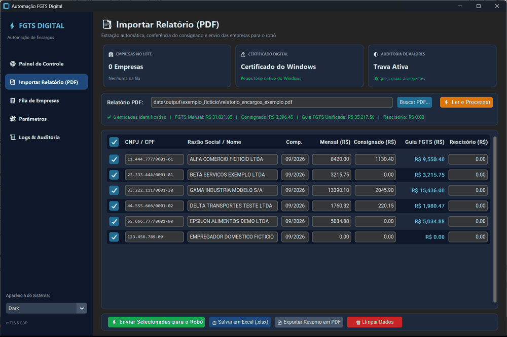
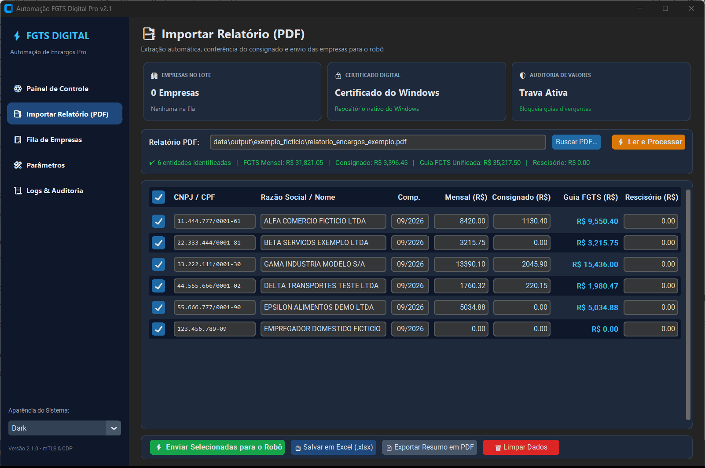
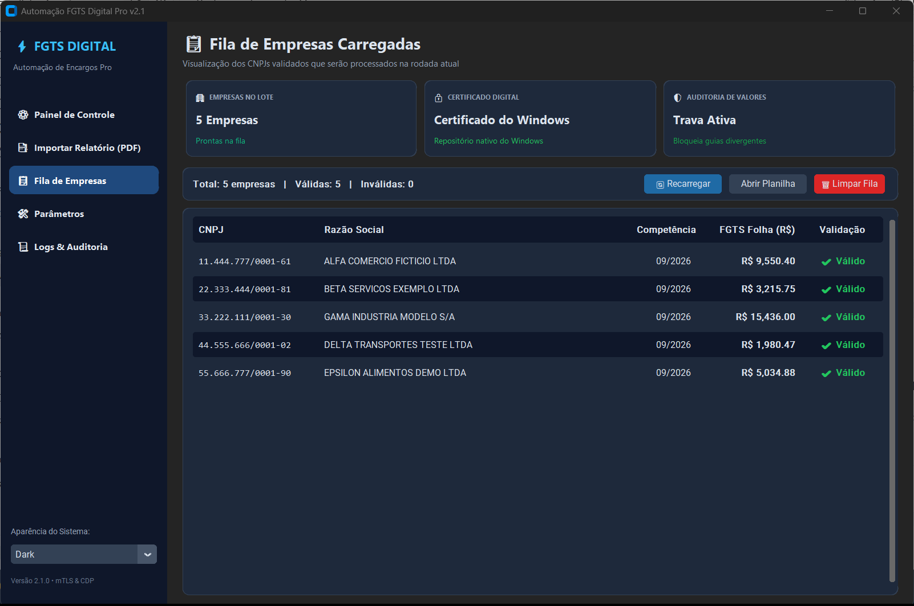
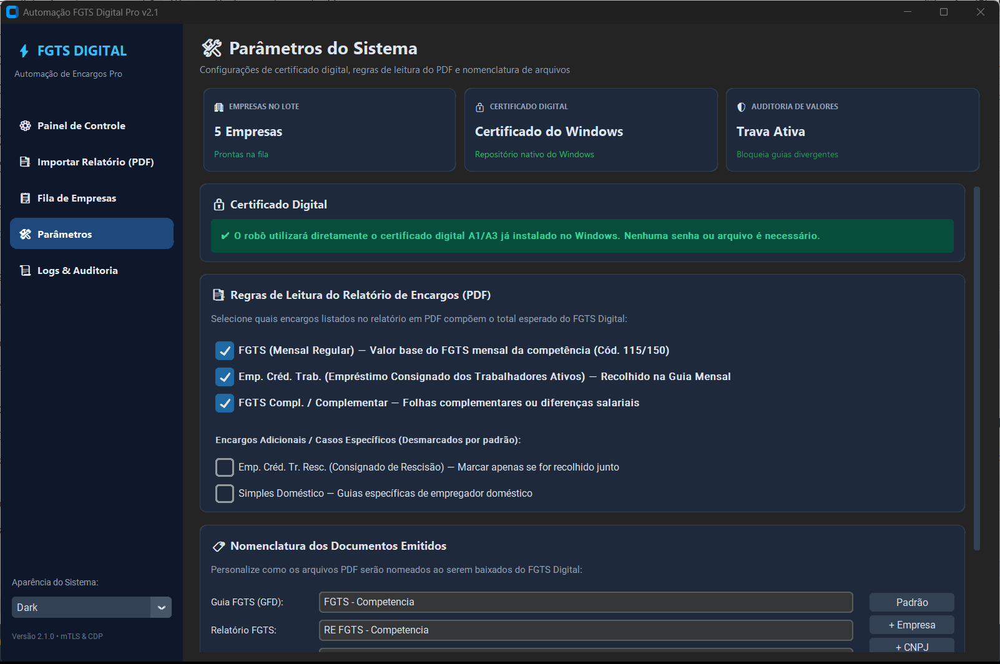
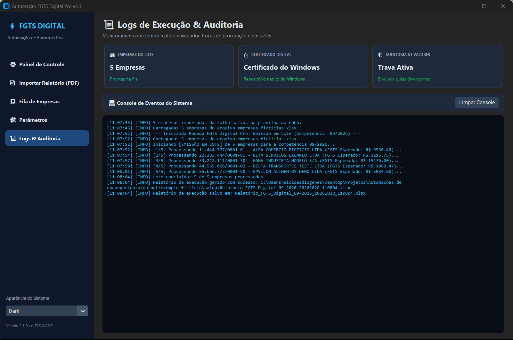
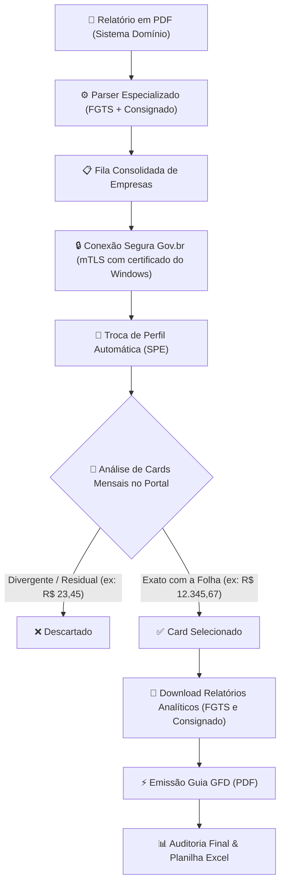

<p align="center">
  
</p>

<p align="center">
  
  
  
  
  
</p>

Sistema corporativo de alto desempenho desenvolvido para escritórios de contabilidade e departamentos fiscais/DP. Automatiza o acesso ao portal **FGTS Digital**, gerencia procurações eletrônicas (**SPE**), audita valores de encargos e emite em lote as **Guias do FGTS Digital (GFD)** e seus respectivos **Relatórios Analíticos de Débitos**.

---

## 📑 Sumário

- [Visão Geral](#-visão-geral)
- [Demonstração do Fluxo em Ação](#-demonstração-do-fluxo-em-ação)
- [Principais Funcionalidades](#-principais-funcionalidades)
- [Interface Gráfica (v2.1)](#-interface-gráfica-v21)
- [Inteligência de Reconhecimento Multi-Cards](#-inteligência-de-reconhecimento-multi-cards)
- [Arquitetura e Tecnologias](#-arquitetura-e-tecnologias)
- [Documentação Técnica](#-documentação-técnica)
- [Modos de Operação](#-modos-de-operação)
  - [1. Emissão de Guias e Relatórios (Padrão)](#1-emissão-de-guias-e-relatórios-padrão)
  - [2. Modo "Apenas Conferir" (Auditoria de Folha)](#2-modo-apenas-conferir-auditoria-de-folha)
- [Autenticação e Certificados Digitais](#-autenticação-e-certificados-digitais)
- [Instalação e Configuração](#-instalação-e-configuração)
- [Guia de Uso Passo a Passo](#-guia-de-uso-passo-a-passo)
- [Personalização de Nomenclatura](#-personalização-de-nomenclatura)
- [Estrutura do Projeto](#-estrutura-do-projeto)
- [Testes Automatizados](#-testes-automatizados)
- [Segurança e Conformidade LGPD](#-segurança-e-conformidade-lgpd)

---

## 🌟 Visão Geral

O fechamento mensal de encargos trabalhistas exige a apuração e geração de guias para dezenas ou centenas de empresas clientes. O portal do **FGTS Digital** demanda autenticação Gov.br via mTLS, troca manual de perfil por procuração outorgada e consultas individuais.

A **Automação FGTS Digital Pro** elimina o trabalho manual repetitivo:
1. Conecta-se com o Certificado Digital do contador instalado no Windows (A1 ou token A3).
2. Lê a lista de empresas outorgantes (via planilha Excel ou diretamente do relatório em PDF do Sistema Domínio).
3. Efetua a troca de perfil para cada cliente no portal via Procuração Eletrônica (SPE).
4. Audita se o valor no FGTS Digital bate com o relatório de encargos (com suporte consolidado a FGTS Mensal e FGTS de empréstimo consignado).
5. Emite as guias GFD em PDF e baixa os relatórios detalhados de débitos.
6. Organiza tudo em pastas por competência e gera uma planilha consolidada com o status de cada empresa.

---

## 🎬 Demonstração do Fluxo em Ação

### Interface real (dados fictícios)

<p align="center">
  
</p>

Importação do relatório do Domínio → envio das empresas para a fila → execução do lote (robô simulado na gravação) → registro nos logs. Todas as empresas, CNPJs e valores são **fictícios**.

### Esteira no portal (ilustração)

<p align="center">
  
</p>

Ilustração (não é captura do portal, para não expor dados de clientes) das cinco etapas executadas pelo robô:
1. **Importação e Leitura**: CNPJs, razões sociais e encargos do relatório do Sistema Domínio.
2. **Conexão mTLS**: login no Gov.br com o certificado instalado no Windows.
3. **Troca de Perfil SPE**: procuração eletrônica de cada cliente, com confirmação do CNPJ ativo.
4. **Seleção do card Mensal**: escolha da guia certa mesmo com débitos residuais ou retificadoras.
5. **Emissão e Auditoria**: GFD e relatórios analíticos validados, planilha Excel consolidada.

---

## 🚀 Principais Funcionalidades

- **Certificado Digital instalado no Windows**:
  - Acesso automático aos certificados A1/A3 instalados na máquina, sem selecionar arquivo nem digitar senha no programa.
  - O modo de certificado em arquivo `.pfx` foi removido em 27/10/2026: ele quebra o captcha do Gov.br ([ADR-0004](docs/decisoes/ADR-0004-remocao-do-modo-pfx.md)).
- **Importador de Relatórios em PDF (Exclusivo Sistema Domínio)**:
  - Atualmente projetado para leitura e extração exclusiva do modelo de relatório em PDF gerado pelo **Sistema Domínio (Thomson Reuters)**.
  - Extração automática de CNPJs/CPFs, razões sociais e encargos: **FGTS** (todas as linhas iniciadas por "FGTS", inclusive 13º), **FGTS Compl.**, **Emp. Créd. Trab.** (consignado do trabalhador ativo), **Emp. Créd. Tr. Resc.** (consignado rescindido), **Simples doméstico** e **FGTS Rescisório** (com o nome do empregado). Quais encargos entram no FGTS esperado é configurável em Parâmetros.
- **Modo "Apenas Conferir Valores"**:
  - Consulta os débitos apurados no portal e cruza com os valores esperados sem emitir ou recalcular guias.
  - Alerta sobre divergências de centavos, guias já quitadas ou ausência de débitos.
- **Nomenclatura Totalmente Flexível**:
  - Padrões configuráveis para Guia FGTS, Relatório Analítico e Relatório Consignado.
  - Tags `Competencia` (ou `Comp`), `CNPJ`, `Empresa` (ou `Razao`), com ou sem chaves — ex.: `FGTS - {competencia} - {empresa}`. Sem chaves, só a palavra isolada é trocada ("Comprovante" não é alterado).
- **Painel Executivo em Tempo Real**:
  - Cards de KPI simétricos e responsivos acompanhando o progresso da fila.
  - Barra de rolagem nativa para acomodar telas de qualquer resolução (laptops a monitores ultrawide).
- **Relatório de Auditoria em Excel**:
  - Planilha analítica gerada ao final da execução detalhando cada operação, valores, diferenças e caminhos dos arquivos salvos.

---

## 🖥 Interface Gráfica (v2.1)

<p align="center">
  
</p>

<table>
  <tr>
    <td width="50%"><br><sub><b>Importar Relatório (PDF)</b> — leitura do relatório do Domínio</sub></td>
    <td width="50%"><br><sub><b>Fila de Empresas</b> — o que o robô vai processar</sub></td>
  </tr>
  <tr>
    <td width="50%"><br><sub><b>Parâmetros</b> — certificado, regras de leitura e nomenclatura</sub></td>
    <td width="50%"><br><sub><b>Logs & Auditoria</b> — acompanhamento do lote</sub></td>
  </tr>
</table>

Imagens geradas da interface real com dados fictícios por `scripts/capturar_telas.py`.

1. **Sidebar Lateral de Navegação**:
   - ⚙ **Painel de Controle**: Configuração da competência de apuração, opções de auditoria/emissão, seleção de pastas e armazenamento e acionamento do robô.
   - 📑 **Importar Relatório (PDF)**: Leitor inteligente do relatório de encargos do **Sistema Domínio** com visualização em tabela editável e exportação para Excel/PDF.
   - 📋 **Fila de Empresas**: Gestão da planilha de CNPJs carregados, contadores e status de execução.
   - 🛠 **Parâmetros**: Informação do Certificado Digital (instalado no Windows), regras de leitura do PDF (FGTS Mensal, Consignado e Complementares) e personalização da nomenclatura dos documentos emitidos, com persistência automática em `config/parametros.json`.
   - 📜 **Logs & Auditoria**: Console com terminal em tempo real e monitoramento dos passos do robô.
2. **Cards de Status e KPIs Executivos**:
   - **Empresas no Lote**: Quantidade de clientes na fila de processamento.
   - **Certificado Digital**: Indica que o robô usa o certificado instalado no Windows.
   - **Auditoria de Valores**: Indicador visual da trava anti-divergência de valores com a folha.
3. **Persistência Centralizada**:
   - Todas as configurações e regras de encargos são salvas em `config/parametros.json` e recarregadas automaticamente ao abrir o sistema.

---

## 🧠 Inteligência de Reconhecimento Multi-Cards

Em cenários reais do portal FGTS Digital, uma mesma competência pode apresentar **mais de um card de Guia Mensal** (por exemplo, quando há um débito residual de competência retificada e a guia principal da folha regular com empréstimo consignado):

<p align="center">
  
</p>

### Como o Robô Seleciona o Card Correto:
1. **Identificação dos Blocos**: O robô faz a varredura de todos os containers contendo o cabeçalho `Mensal - Vencimento`.
2. **Cálculo Consolidado**: Para cada card, soma as tabelas internas de **FGTS** e **Consignado**.
3. **Cruzamento de Precisão**: Escolhe o card cujo `Total Guia` fica **mais próximo** do valor apurado na folha do Sistema Domínio (`fgts_esperado`).
4. **Descarte de Falsas Divergências**: Ignora guias residuais ou retificadoras (ex: R$ 23,45). Se nem o card mais próximo bater com a folha (diferença acima de R$ 0,02), a **trava de divergência** impede a emissão ([travas](#-travas-de-segurança-da-emissão-v21)).
5. **Independência de Vencimento**: A seleção independe de a data ser dia 20 ou antecipada por finais de semana e feriados.

---

## 🛠 Arquitetura e Tecnologias



- **Linguagem**: Python 3.12
- **Automação Web / Navegador**: [Playwright](https://playwright.dev/python/) com Chromium controlado por DevTools Protocol (CDP).
- **Interface Gráfica**: [CustomTkinter](https://customtkinter.tomschimansky.com/) com design system dark/light contemporâneo.
- **Processamento de Dados**: `pandas`, `openpyxl`.
- **Extração de Documentos**: `pypdf`, `pdfplumber` e expressões regulares especializadas no layout do Sistema Domínio.
- **Criptografia e Certificados**: `cryptography` (OpenSSL backend para parsing PKCS#12 e X.509).
- **Testes**: `pytest` com suíte completa de testes unitários e de integração locais.

---

## 📚 Documentação Técnica

Documentação completa em [`docs/`](docs/README.md):

| Documento | Conteúdo |
| :--- | :--- |
| [Arquitetura](docs/arquitetura.md) | Componentes, fluxo de cada empresa no lote, threads, integrações e tecnologias |
| [Desenvolvimento](docs/desenvolvimento.md) | Ambiente, configuração, convenções, fluxo de testes e roteiro de teste no portal real |
| [Problemas conhecidos](docs/problemas-conhecidos.md) | Pendências abertas e causas raiz já resolvidas |
| [Decisões (ADR)](docs/decisoes/README.md) | Decisões técnicas com alternativas e motivos |

---

## 🎯 Modos de Operação

### 1. Emissão de Guias e Relatórios (Padrão)
Para cada empresa da lista:
1. Alterna o perfil do usuário logado para o CNPJ do cliente.
2. Acessa a opção **Gestão de Guias** > **Emissão de Guia Rápida**.
3. Seleciona a competência de apuração.
4. Emite a **GFD** e efetua o download do PDF.
5. Emite e baixa o **Relatório Analítico de Débitos** (FGTS e Consignado).
6. Salva e renomeia os arquivos na pasta da competência.

### 🛡 Travas de Segurança da Emissão (v2.1)
O robô segue a regra **"na dúvida, não emite"**. Cada empresa só tem guia emitida se passar por todas as travas:

| Trava | O que verifica | Status quando bloqueia |
| :--- | :--- | :--- |
| **Confirmação de perfil** | Após a troca por procuração, o modal fecha e a barra de perfil exibe a raiz do CNPJ escolhido. | `Perfil não confirmado` |
| **Valor de referência** | Existe valor esperado (folha/relatório) para conferir. Pode ser desligado no painel em *"Exigir valor esperado da folha para emitir a guia"*. | `Sem Valor de Referência (Não Emitida)` |
| **Card Mensal** | O botão *Emitir guia* clicado está dentro do card Mensal selecionado — nunca em card Rescisório ou residual. | `Card Mensal Não Identificado (Não Emitida)` |
| **Divergência** | Diferença entre portal e folha até R$ 0,02. | `Divergência de Valores (Não Emitida)` |
| **Conteúdo dos relatórios** | Cada relatório baixado contém a raiz do CNPJ e a competência. Se reprovar, a guia não é emitida. | `Falha na Validação do PDF (Relatório) - Guia Não Emitida` |
| **Conteúdo da guia** | A GFD baixada contém raiz do CNPJ, competência e valor do card, e não é cópia de um relatório já salvo. | `Falha na Validação do PDF (Guia)` |

PDFs reprovados nunca ficam com o nome final: são movidos para a subpasta `_rejeitados/` da empresa. No caso de `Falha na Validação do PDF (Guia)`, a guia **foi solicitada no portal** — confira manualmente no FGTS Digital.

> ✅ **Confirmação de perfil validada no portal real (27/10/2026):** o portal exibe `Empregador: 11.444.777/0001-61 | RAZÃO SOCIAL` em `span.dados-perfil`; a trava confirmou corretamente a troca para 3 empresas.
>
> ⚠️ **Validação pendente no portal real:** o formato do texto dos PDFs reais (GFD e relatórios analíticos) ainda precisa ser confirmado numa emissão real. Até lá, se os PDFs vierem em outro formato, as travas reprovam o arquivo em vez de arriscar.

### 2. Modo "Apenas Conferir" (Auditoria de Folha)
Ativado marcando a opção **"Apenas conferir se o valor do relatório e do sistema está igual"**:
1. O robô acessa o FGTS Digital e localiza a apuração da competência.
2. Captura o valor total de débitos apurados no portal.
3. Cruza com o valor extraído da folha de pagamento do cliente.
4. Se houver divergência, registra o valor da diferença no relatório e sinaliza no log.
5. **Nenhuma guia é emitida**, preservando o status da declaração para conferência prévia.

---

## 🔐 Autenticação e Certificados Digitais

O robô autentica no Gov.br **somente com o certificado digital instalado no Windows** (A1 importado ou token A3):

1. Abre (ou reaproveita) o **Google Chrome do sistema** com perfil próprio em `data/browser_profile/` e o controla pela porta local 9222 ([ADR-0001](docs/decisoes/ADR-0001-chrome-nativo-cdp-porta-9222.md)).
2. O Chrome faz o mTLS pela pilha nativa do Windows e seleciona o certificado automaticamente nas origens `*.acesso.gov.br` e `*.sistema.gov.br`.
3. Se o Gov.br mostrar **captcha**, o robô avisa no log e espera até 4 minutos o operador resolver na janela.
4. Sem Google Chrome instalado, usa o Chromium do Playwright com o mesmo repositório de certificados do Windows (reserva).

> **Por que não há modo de certificado em arquivo (`.pfx`)?** No Playwright, a única forma de apresentar um `.pfx` sem instalá-lo no Windows é o `client_certificates`, que cria um proxy interno e bloqueia os serviços de captcha; o Gov.br então responde **ERL0033800 – "Captcha inválido"**. O modo foi removido em 27/10/2026 — [ADR-0004](docs/decisoes/ADR-0004-remocao-do-modo-pfx.md). Para usar um certificado A1 em arquivo, **instale-o no Windows** (duplo clique no `.pfx` → Usuário Atual).

---

## 📦 Instalação e Configuração

### Pré-requisitos
- **Windows 10 ou 11** (64 bits).
- **Python 3.12** (versão testada) instalado e adicionado ao `PATH`.
- Google Chrome ou Chromium instalado.

### 1. Clonar o Repositório
```bash
git clone https://github.com/AlcidesDiogenes/automacao-fgts-digital.git
cd automacao-fgts-digital
```

### 2. Criar e Ativar o Ambiente Virtual
```powershell
python -m venv venv
.\venv\Scripts\Activate.ps1
```

### 3. Instalar Dependências
```powershell
pip install -r requirements.txt
playwright install chromium
```

### 4. Configurar Arquivo `.env` (Opcional)
Se desejar definir configurações padrão via linha de comando ou CLI:
```powershell
cp config/.env.example config/.env
```
Edite `config/.env` com seus caminhos preferenciais.

---

## 🚦 Guia de Uso Passo a Passo

### Inicialização Rápida no Windows
Basta dar um duplo clique no executável em lote:
- `iniciar.bat` (Abre a aplicação com interface gráfica)
- `iniciar_com_console.bat` (Abre a aplicação com janela de console auxiliar para depuração detalhada)

### Execução via Terminal (CLI)
A linha de comando usa as mesmas preferências da interface (`config/parametros.json`: nomenclatura e "exigir valor esperado") e o certificado instalado no Windows.
Você também pode disparar a automação diretamente por linha de comando:
```powershell
# Execução da competência anterior
.\venv\Scripts\python.exe main.py --cli --competencia anterior

# Execução com competência específica
.\venv\Scripts\python.exe main.py --cli --competencia 09/2026

# Apenas conferir valores (não emite guias)
.\venv\Scripts\python.exe main.py --cli --conferir --competencia 09/2026
```

---

## 📝 Personalização de Nomenclatura

Na tela de **Parâmetros**, é possível definir a estrutura do nome dos arquivos gerados:

* **Guia FGTS**:
  - Padrão: `FGTS - {competencia}`
  - Exemplo gerado: `FGTS - 09-2026.pdf`
* **Relatório Analítico FGTS**:
  - Padrão: `RE FGTS - {competencia}`
  - Exemplo gerado: `RE FGTS - 09-2026.pdf`
* **Relatório Consignado**:
  - Padrão: `Consignado FGTS - {competencia}`
  - Exemplo gerado: `Consignado FGTS - 09-2026.pdf`

Também é possível combinar o CNPJ e o nome da empresa nas configurações avançadas.

---

## 📂 Estrutura do Projeto

```text
automacao-fgts-digital/
├── .agents/                    # Diretrizes e regras de arquitetura e UI
├── config/
│   ├── .env.example            # Modelo de configuração de variáveis
│   ├── parametros.json         # Persistência de preferências e regras
│   └── settings.py             # Gerenciador central de configurações
├── data/
│   ├── logs/                   # Logs de execução (ignorado no git)
│   └── output/                 # Pastas de saída com PDFs e planilhas geradas
├── docs/
│   ├── README.md               # Índice da documentação técnica
│   ├── arquitetura.md          # Componentes, fluxos, threads e integrações
│   ├── desenvolvimento.md      # Ambiente, convenções e fluxo de testes
│   ├── problemas-conhecidos.md # Pendências e causas raiz
│   ├── assets/                 # Imagens e GIFs do README (dados fictícios)
│   └── decisoes/               # Registro de decisões técnicas (ADR)
├── scripts/
│   ├── generate_assets.py      # Gera as ilustrações do README (banner, multi-cards, esteira)
│   ├── capturar_telas.py       # Captura as telas reais da interface com dados fictícios
│   └── diagnostico/            # Scripts manuais que acessam o portal real (não são testes)
├── src/
│   ├── core/                   # Módulos de apoio (navegador e Excel)
│   │   ├── browser.py          # Abertura/conexão do Chrome (CDP 9222) com certificado do Windows
│   │   └── excel_manager.py    # Geração e leitura de planilhas de lote
│   ├── modules/
│   │   ├── fgts_digital/       # Robô de automação do portal federal
│   │   │   ├── bot.py          # Lógica de navegação, troca de perfil e download
│   │   │   ├── parser.py       # Extração e normalização de débitos
│   │   │   ├── selectors.py    # Mapeamento de seletores CSS e XPath
│   │   │   └── validacao_pdf.py # Conferência do conteúdo dos PDFs baixados (CNPJ, competência, valor)
│   │   └── folha_relatorio/    # Leitor de relatórios do Sistema Domínio
│   │       └── parser_pdf.py   # Parsing de PDFs e rubricas de encargos
│   └── ui/                     # Interface Gráfica CustomTkinter
│       ├── app.py              # Janela principal com responsividade e KPIs
│       └── theme.py            # Design tokens, cores e fontes
├── tests/                      # Somente testes automatizados (pytest), sem acesso ao portal real
├── iniciar.bat                 # Script de inicialização rápida
├── main.py                     # Entrypoint da aplicação (GUI & CLI)
├── pytest.ini                  # Configurações do pytest
├── requirements.txt            # Dependências do projeto
└── README.md                   # Documentação oficial
```

---

## 🧪 Testes Automatizados

O projeto conta com testes unitários cobrindo o gerenciamento de certificados, validação de planilhas Excel, parsing de relatórios de encargos e as travas de segurança da emissão:

```powershell
.\venv\Scripts\python.exe -m pytest -v
```

- `tests/test_bot_seguranca.py` roda o robô contra um **portal FGTS Digital falso** (HTML servido pelo próprio Playwright por interceptação de rotas — nenhuma requisição sai para a internet). Requer o Chromium do Playwright (`playwright install chromium`).
- `tests/test_validacao_pdf.py` gera PDFs sintéticos com `reportlab` e testa a validação de conteúdo.
- `tests/test_bot_esperas.py` testa as esperas do robô (o `is_visible(timeout=...)` do Playwright ignora o timeout) e a detecção imediata de "sem débitos".
- `tests/test_ui_execucao.py` abre a janela real com robô e navegador falsos: contadores, mensagem final, botão *Parar*, nenhuma chamada ao Tkinter fora da thread principal (inclusive pelo log) e logs simultâneos das duas threads sem travar.
- `tests/test_browser_modos.py` confere a abertura do navegador (reaproveitar o Chrome via CDP, reservas) e garante que **nenhum caminho usa `client_certificates`** (regressão do captcha, ADR-0004).
- `tests/test_logger.py` garante que o arquivo `data/logs/execucao_AAAA-MM-DD.log` é criado.

A pasta `tests/` contém **somente testes automáticos**: nenhum deles acessa o portal real (o `pytest` roda tudo, sem exclusões). Se algum teste passar de 5 minutos, o `pytest` imprime a pilha de todas as threads (`faulthandler_timeout` no `pytest.ini`), para diagnosticar travamentos.

### Diagnóstico manual (portal real)

Scripts em `scripts/diagnostico/` abrem o FGTS Digital de verdade com o certificado instalado no Windows. Não fazem parte da suíte e podem exigir captcha resolvido pelo operador. Rode na raiz do projeto:

| Script | Quando usar |
| :--- | :--- |
| `login_real.py` | Conferir se o login do robô ainda funciona (mostra SUCESSO/FALHA e salva `data/logs/tela_pos_login.png`). |
| `debug_govbr_dom.py` | O Gov.br mudou a tela de login: lista os seletores do botão "Seu certificado digital" e acompanha o redirecionamento. |

```powershell
.\venv\Scripts\python.exe scripts\diagnostico\login_real.py
```

Para conferir valores no portal sem emitir guias, use a própria linha de comando: `main.py --cli --conferir`.

---

## 🔒 Segurança e Conformidade LGPD

* **Zero Exposição de Chaves**: Arquivos de certificados digitais (`.pfx`, `.p12`, `.pem`, `.key`, `.crt`) e arquivos `.env` com senhas estão permanentemente bloqueados pelo `.gitignore`.
* **Privacidade dos Trabalhadores**: Nenhum relatório com dados de colaboradores (CPF, salários, bases de cálculo) é mantido em repositórios remotos.
* **Sessão persistente (não é limpa a cada execução)**: o robô usa perfil próprio do Chrome em `data/browser_profile/` e **mantém a janela aberta** ao fim do lote para reaproveitar o login no Gov.br. O perfil guarda cookies de sessão e fica fora do Git.
* **Porta de depuração 9222 — só em computador individual**: enquanto a janela do robô estiver aberta, qualquer programa **do mesmo computador** pode controlar a sessão de procurador por essa porta (ela não é acessível pela rede). Por isso o programa **não deve rodar em servidor compartilhado** (Terminal Server/RDS). Detalhes e alternativas em [ADR-0001](docs/decisoes/ADR-0001-chrome-nativo-cdp-porta-9222.md).
* **Mascaramento de automação**: o navegador oculta sinais de automação para reduzir bloqueios do WAF do Gov.br; captchas são sempre resolvidos pelo operador. Riscos registrados em [ADR-0002](docs/decisoes/ADR-0002-mascaramento-de-automacao-stealth.md).
* **Dados de navegador fora do repositório**: perfis, cookies e qualquer banco `*.db` (ex.: cópias de histórico do Chrome) são ignorados pelo Git em qualquer pasta — [ADR-0005](docs/decisoes/ADR-0005-dados-de-navegador-fora-do-repositorio.md).
* **Sem senha de certificado no projeto**: o robô não lê mais `PFX_PATH`/`PFX_PASSWORD`. Se o seu `config/.env` ainda tiver essas linhas, apague-as.

Todas as decisões técnicas: [docs/decisoes](docs/decisoes/README.md).

---

## 👤 Autor e Manutenção

Desenvolvido para otimização e auditoria contábil digital por **Alcides Diogenes**.

Dúvidas ou sugestões? Abra uma [Issue](https://github.com/AlcidesDiogenes/automacao-fgts-digital/issues) no repositório.
