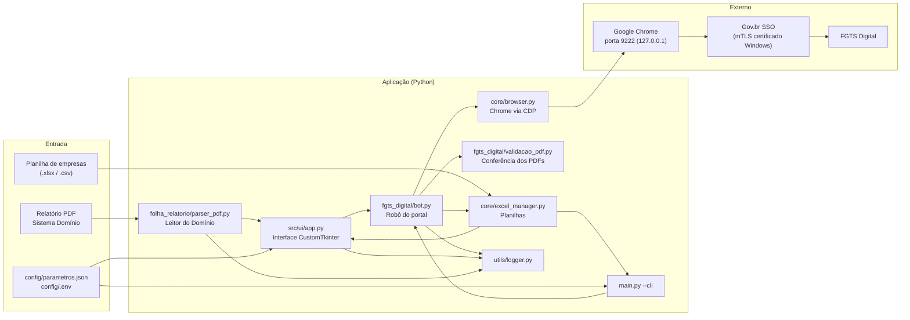
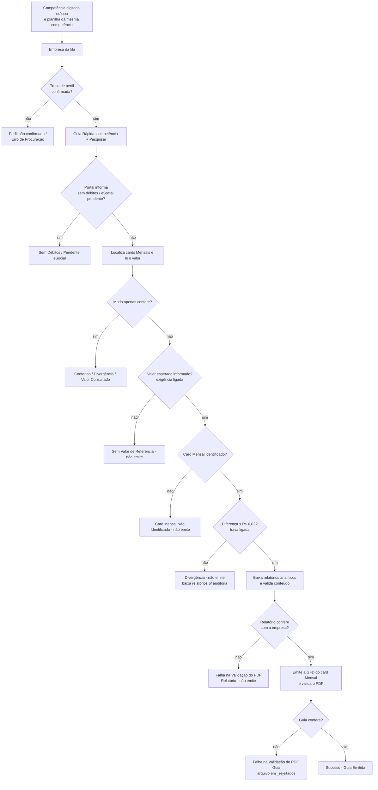

# Arquitetura

> Revisado na auditoria de 27–28/10/2026. Atualize este documento no mesmo commit de qualquer mudança de componente, fluxo ou integração.

## Visão geral

Aplicação desktop Windows que lê os encargos de FGTS calculados na folha (relatório "Pagamento de Encargos" do **Sistema Domínio** ou planilha), entra no **FGTS Digital** pelo Gov.br com o certificado do contador instalado no Windows, troca o perfil por **procuração eletrônica** para cada empresa cliente, confere o valor apurado no portal contra a folha e emite a **GFD** (guia) e os relatórios analíticos — ou apenas confere, sem emitir.

Regra central desde a auditoria de 27/10/2026: **na dúvida, não emite** ([ADR-0003](decisoes/ADR-0003-travas-da-emissao.md)).

## Componentes

| Componente | Arquivo | Responsabilidade |
| :--- | :--- | :--- |
| Ponto de entrada | `main.py` | Abre a interface (padrão) ou executa em linha de comando (`--cli`, `--conferir`, `--competencia`, `--excel`, `--output`, `--headless`). |
| Configuração | `config/settings.py`, `config/parametros.json`, `config/.env` | Caminhos absolutos a partir da raiz do projeto, preferências persistidas (regras de leitura, nomenclatura, pasta de saída, "exigir valor esperado"), variáveis de ambiente. |
| Interface | `src/ui/app.py`, `src/ui/theme.py` | Telas: Painel, Importar Relatório (PDF), Fila de Empresas, Parâmetros, Logs. Executa o robô numa thread separada. |
| Leitor do Domínio | `src/modules/folha_relatorio/parser_pdf.py` | Extrai CNPJ/CPF, razão social, competência e totais por encargo (FGTS, FGTS complementar, consignado ativo e rescindido, Simples Doméstico, FGTS rescisório) e soma conforme as regras de leitura. Exporta para Excel/PDF. |
| Planilhas | `src/core/excel_manager.py` | Lê a fila de empresas, cria o modelo e gera o relatório da execução (`Relatorio_FGTS_Digital_<competência>_<data-hora>.xlsx`). |
| Navegador | `src/core/browser.py` | Conecta ao Chrome na porta 9222 (ou o abre com perfil `data/browser_profile/`); reserva: perfil persistente do Playwright. Somente certificado instalado no Windows ([ADR-0001](decisoes/ADR-0001-chrome-nativo-cdp-porta-9222.md), [ADR-0004](decisoes/ADR-0004-remocao-do-modo-pfx.md)). |
| Robô | `src/modules/fgts_digital/bot.py` | Login no Gov.br, troca de perfil, Guia Rápida (competência, cards Mensais), conferência de valores, download de relatórios, emissão da GFD, laço do lote (`processar_lote`). |
| Seletores | `src/modules/fgts_digital/selectors.py` | Seletores CSS do portal (o que mais quebra quando o portal muda). |
| Utilitários do robô | `src/modules/fgts_digital/parser.py` | CNPJ, competência, valores em formato brasileiro, nomenclatura dos arquivos, extração do valor do card Mensal. |
| Validação de PDF | `src/modules/fgts_digital/validacao_pdf.py` | Confere que cada PDF baixado contém a raiz do CNPJ, a competência e (na guia) o valor. |
| Logs | `src/utils/logger.py` | Console, arquivo `data/logs/execucao_AAAA-MM-DD.log` e listener da tela de Logs. |

## Fluxo de uma empresa no lote

Saídas por empresa: `<pasta de saída>/<MM-AAAA>/<CNPJ>_<razão social>/` com a guia e os relatórios (nomes configuráveis); arquivos reprovados vão para a subpasta `_rejeitados/`. Ao fim do lote: `Relatorio_FGTS_Digital_<MM-AAAA>_<data-hora>.xlsx` na pasta de saída.

## Modelo de threads (interface)

- **Thread principal:** único lugar onde o Tkinter é usado.
- **Thread do robô:** recebe as opções da tela já lidas (`_coletar_config_execucao`) e roda `processar_lote`.
- **Comunicação:** fila única `queue.Queue` (`self._fila_ui`). Logs e atualizações de tela vindos de qualquer thread só fazem `put`; a thread principal esvazia a fila a cada 50 ms (`_drenar_fila_ui`). Chamar `after()` ou widgets fora da thread principal causou um deadlock real em 28/10/2026 (ver [problemas conhecidos](problemas-conhecidos.md)).
- **Parar:** `threading.Event` (`evento_parar`) verificado antes de cada empresa.

## Integrações externas

| Integração | Como | Observações |
| :--- | :--- | :--- |
| Gov.br SSO | Navegador, botão "Seu certificado digital" (mTLS com o certificado do Windows) | Pode exigir captcha: o operador resolve na janela (robô espera até 4 min). |
| FGTS Digital | Navegador (CDP), telas de troca de perfil e Gestão de Guias › Emissão de Guia Rápida | Sem API pública conhecida para procurador (não verificado). Seletores em `selectors.py`. |
| Sistema Domínio | Relatório PDF "Pagamento de Encargos" | Leitor específico para esse layout; outros sistemas de folha não são suportados. |

## Tecnologias e por quê

| Tecnologia | Por quê |
| :--- | :--- |
| Python 3.12 | Ecossistema de automação (Playwright), PDF e Excel; código existente. |
| Playwright + Google Chrome via CDP | Chrome do sistema autentica com o certificado do Windows e não dispara o WAF como o Chromium automatizado ([ADR-0001](decisoes/ADR-0001-chrome-nativo-cdp-porta-9222.md), [ADR-0002](decisoes/ADR-0002-mascaramento-de-automacao-stealth.md)). |
| CustomTkinter | Interface desktop nativa sem servidor web. |
| pypdf / pdfplumber | Leitura do relatório do Domínio e validação dos PDFs baixados. |
| pandas / openpyxl | Planilhas de entrada e relatório de execução. |
| reportlab | Exportação em PDF e PDFs sintéticos dos testes. |
| pytest | Testes automatizados ([ADR-0006](decisoes/ADR-0006-fluxo-de-testes.md)). |

Rust foi avaliado como linguagem preferencial do workspace, mas não se aplica: o projeto existente é Python e depende de Playwright/Tkinter; reescrever não traria ganho.
